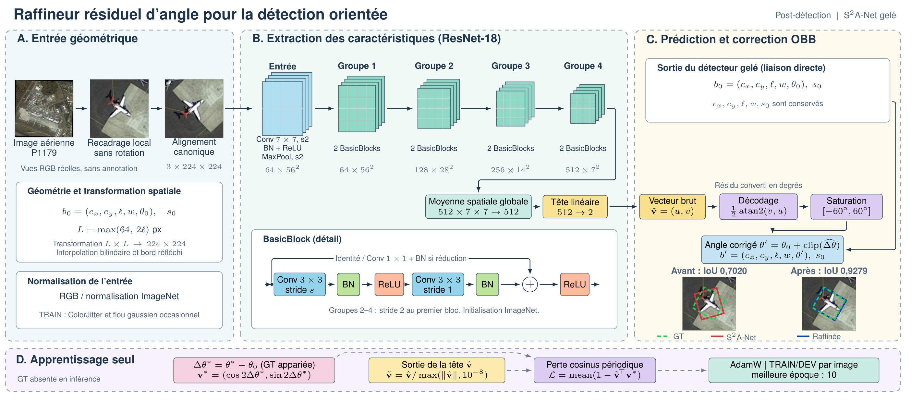
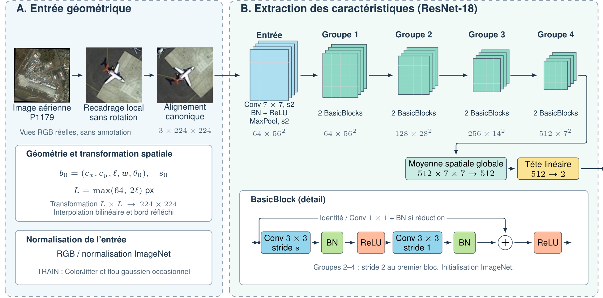
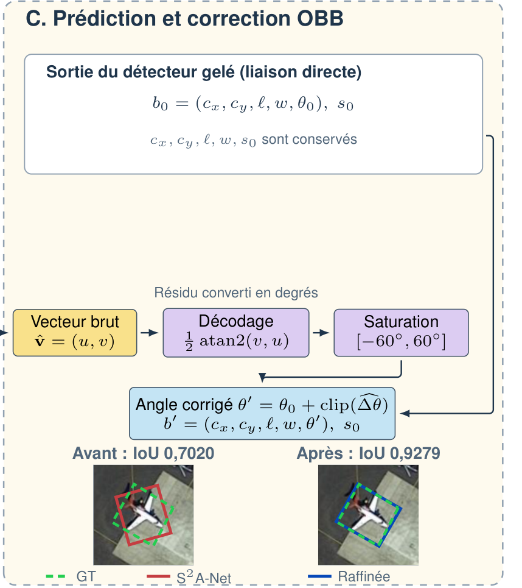
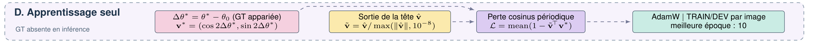
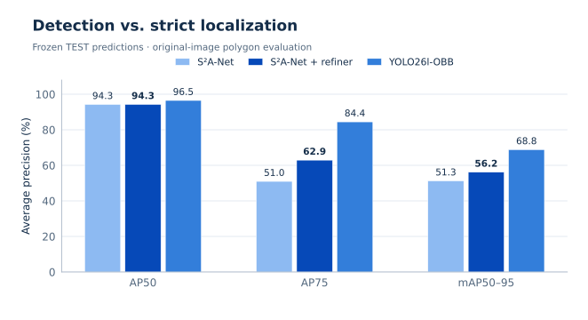
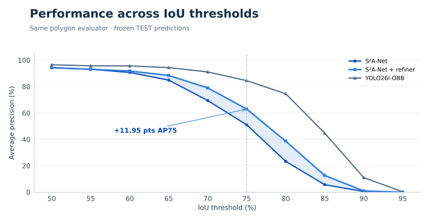
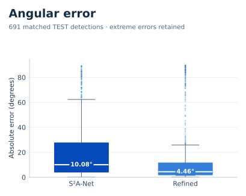
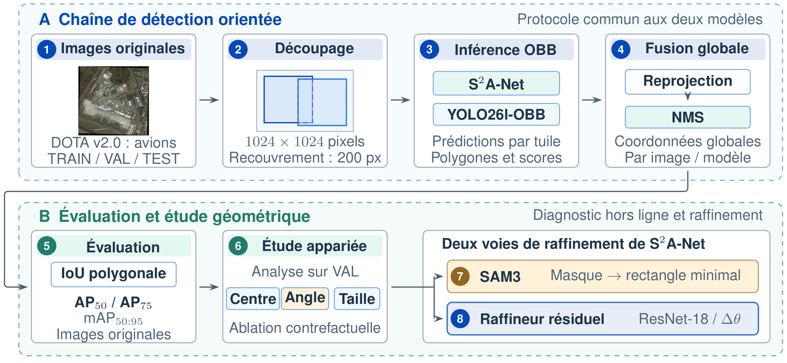

<h1 align="center">Beyond AP50</h1>

<strong>Geometry-aware diagnosis and residual orientation refinement for aircraft detection in aerial imagery</strong>

  
  
  
  
  

<a href="#overview">Overview</a> · <a href="#proposed-architecture">Architecture</a> · <a href="#experimental-results">Results</a> · <a href="#experimental-protocol">Protocol</a> · <a href="#reproducibility">Reproducibility</a>

<table>
<tr>
<td align="center" width="33%"><h2>+11.95 pts</h2><strong>AP75 improvement</strong> 50.97% → 62.92%</td>
<td align="center" width="33%"><h2>−55.7%</h2><strong>Median angular error</strong> 10.08° → 4.46°</td>
<td align="center" width="33%"><h2>94.26%</h2><strong>AP50 maintained</strong> Frozen TEST predictions</td>
</tr>
</table>

## Overview

Detecting an aircraft is not the same as localizing it precisely. This project investigates why oriented detectors with similar AP50 can exhibit substantially different performance under stricter IoU thresholds. We compare S²A-Net and YOLO26l-OBB on a single-class aircraft subset of DOTA v2.0, diagnose the geometric components of localization errors, investigate SAM3-based refinement, and train a supervised residual angle refiner while keeping S²A-Net frozen.

The contribution is a targeted, experimentally motivated correction of the predicted OBB angle. It is **not a state-of-the-art claim**: YOLO26l-OBB remains the stronger detector on this subset.

## Proposed architecture

Original architecture from Figure 2 of the academic manuscript. Real P1179 RGB crops and actual matched polygons. Click to view at full resolution.

The refiner operates after detection. A canonical 224 × 224 RGB crop is aligned with the predicted OBB axis. An ImageNet-initialized ResNet-18 predicts the two components of a periodic residual, `(cos(2Δθ), sin(2Δθ))`. The residual is decoded using half the two-argument arctangent and clipped to ±60°, selected exclusively on VAL. The center, dimensions, confidence and detector weights remain unchanged. Ground truth is only used for supervision and offline evaluation.

<b>Explore the architecture at a larger scale</b>

### A–B. Geometric input and feature extraction

### C. Periodic prediction and OBB refinement

The illustrated P1179 case improves from IoU 0.7020 to 0.9279. It is a selected example, not an estimate of typical performance.

### D. Training-only path

## Experimental results

### Frozen TEST evaluation

| Method | AP50 (%) | AP75 (%) | mAP50–95 (%) |
|:--|--:|--:|--:|
| S²A-Net | 94.2568 | 50.9730 | 51.2632 |
| **S²A-Net + residual angle refiner** | **94.2568** | **62.9206** | **56.1504** |
| YOLO26l-OBB | 96.4930 | 84.4499 | 68.8126 |

All three sets of frozen TEST predictions were evaluated locally with the same polygon-based evaluator. AP50 remains unchanged for the refined S²A-Net; AP75 gains 11.9476 percentage points.

### Geometry and statistical validation

<table>
<tr><td width="50%" align="center"> Median: 10.0794° → 4.4625°</td><td width="50%" align="center"> Median: 0.78751 → 0.81318</td></tr>
</table>

The geometric analysis retains the original 691 matched TEST true positives. Extreme angular errors remain a limitation despite the reduced median. The 90th percentile rises from 71.08° to 75.15°.

The paired bootstrap uses 5,000 resamples of the 51 original TEST images (seed 42). The AP75 gain has a 95% percentile interval of **[6.7330, 16.8576] points**. These intervals reflect image-level variability, not independent training runs.

<b>Object size analysis and computational characterization</b>

The smallest group (<32 pixels, n=41) exhibits a decrease in conditional localization success. This metric is the fraction of fixed matched detections above IoU 0.75, not AP75.

| Component | Parameters | Mean GPU forward |
|:--|--:|--:|
| S²A-Net | 36,398,156 | 17.06 ms / tile |
| YOLO26l-OBB | 27,875,556 | 7.80 ms / tile |
| Residual angle refiner | 11,177,538 | 0.674 ms / crop (batch 1) |

Measurements were made on an RTX 4090. Tile and crop latencies refer to different inputs and exclude other stages; they are not end-to-end system latency.

## Experimental protocol

Original Figure 1: shared detection protocol, geometric diagnosis and two separate refinement paths.

| Partition | Original images | Positive | Negative | Raw plane annotations | Tiles |
|:--|--:|--:|--:|--:|--:|
| TRAIN | 264 | 211 | 53 | 8,533 | 9,637 |
| VAL | 51 | 41 | 10 | 2,060 | 2,094 |
| TEST | 51 | 41 | 10 | 772 | 846 |
| **Total** | **366** | **293** | **73** | **11,365** | **12,577** |

Images are split before tiling (1024 × 1024; 200 px overlap). Predictions are reprojected and merged before evaluation on original-image polygons. Difficult annotations are ignored according to the evaluator. The refiner's internal DEV split is grouped by original image within TRAIN. No final variant was selected on TEST.

### Why refine only the angle?

On 1,677 common VAL objects, replacing only the angle with the ground-truth-derived angle increased the conditional IoU≥0.75 rate of S²A-Net by 16.04 points, compared with 7.75 for the center and 8.59 for dimensions. This oracle intervention is offline diagnosis, not deployable refinement or an AP75 result. The tested SAM3 mask-to-rectangle configurations did not improve strict localization, motivating supervised angular refinement.

## Reproducibility

The repository contains selected original scripts, aggregated tables, and the figures. The separate academic package contains the collected checkpoints, configurations, runtime exports and experimental evidence. Full retraining and independent model inference have **not** been rerun as part of the final audit.

| Component | Location |
|:--|:--|
| Residual refiner training | [`source/run_obb_angle_refiner.py`](source/run_obb_angle_refiner.py) |
| Frozen TEST evaluation | [`source/eval_angle_refiner_test_frozen.py`](source/eval_angle_refiner_test_frozen.py) |
| Geometric diagnosis | [`source/analyze_step3_final_test_geometry.py`](source/analyze_step3_final_test_geometry.py) |
| Paired bootstrap | [`source/bootstrap_step4_paired_image_level.py`](source/bootstrap_step4_paired_image_level.py) |
| SAM3 experiments | [`source/run_sam3_obb_refinement.py`](source/run_sam3_obb_refinement.py) |
| Numerical results | [`results/`](results/) |
| Validation record | [`docs/FINAL_VALIDATION.md`](docs/FINAL_VALIDATION.md) |
| Execution notes | [`docs/REPRODUCIBILITY.md`](docs/REPRODUCIBILITY.md) |

### Limitations

- Single-class dataset subset, one trained refiner and one refined detector; no official multiclass DOTA leaderboard claim.
- Small targets, near-square OBBs and extreme orientation errors remain difficult.
- The results do not establish that SAM3 is unsuitable for all possible refinement designs.
- The repository does not include raw DOTA data, third-party source trees or model weights. Figure crops are from DOTA-based experiments; check redistribution conditions before public release.

## References

[DOTA](https://captain-whu.github.io/DOTA/) · [S²A-Net](https://github.com/csuhan/s2anet) · [YOLO26](https://docs.ultralytics.com/models/yolo26/) · [ResNet](https://doi.org/10.1109/CVPR.2016.90) · [SAM 3](https://github.com/facebookresearch/sam3)

INFO6544 · Deep Learning · Individual research contribution · Fall 2026

