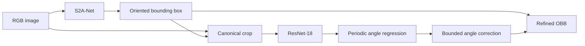
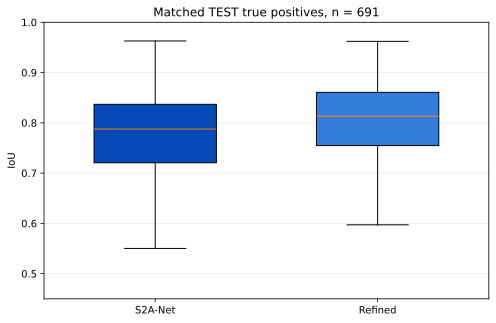
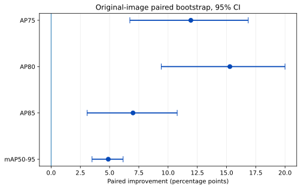
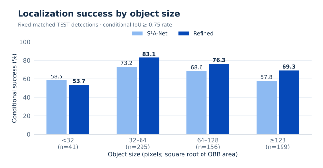

<h1 align="center">Aircraft OBB Refinement</h1>

<b>Beyond AP50: Geometry-aware diagnosis and residual orientation refinement for aircraft detection in aerial imagery</b>

> INFO6544 — Deep Learning, Fall 2026. Individual research contribution. Private reproducibility staging package; review redistribution rights before making it public.

## Overview

This project separates aircraft detection from strict oriented localization. It compares S²A-Net and YOLO26l-OBB on a single-class DOTA v2.0 subset, diagnoses localization errors with matched and counterfactual analyses, explores mask-based refinement, and trains a residual orientation refiner using ResNet-18. The final refiner modifies only the angle of the frozen S²A-Net predictions, with an absolute correction bounded at 60° selected on validation data.

## Main contributions

- Comparative evaluation of S2A-Net and YOLO26l-OBB.
- Matched geometric error analysis.
- Counterfactual localization error analysis.
- Investigation of SAM3-based refinement.
- Supervised residual orientation refinement.
- Paired image-level bootstrap validation.

## Proposed architecture

## Residual refiner

The network takes a canonical aligned crop (224 × 224), encodes a residual angle as `(cos(2Δθ), sin(2Δθ))`, and uses periodic cosine loss. Decoding uses half the two-argument arctangent. The base detector, center, dimensions and confidence are unchanged. Ground truth is used only for supervision and offline evaluation.

## Results on frozen TEST

| Model | AP50 (%) | AP75 (%) | mAP50:95 (%) |
|:--|--:|--:|--:|
| S²A-Net | 94.2568 | 50.9730 | 51.2632 |
| S²A-Net + residual angle refiner | 94.2568 | 62.9206 | 56.1504 |
| YOLO26l-OBB | 96.4930 | 84.4499 | 68.8126 |

**+11.9476 AP75 points**; paired image-level percentile 95% CI [6.7330, 16.8576] (5,000 resamples, 51 original images). AP50 is unchanged. No state-of-the-art claim: YOLO26 remains stronger. Small objects and extreme angular errors are limitations.

## Data and protocol

DOTA v2.0 aircraft subset (`plane` only): 264/51/51 originals in TRAIN/VAL/TEST; 9,637/2,094/846 tiles (1024 × 1024, 200 px overlap). Split before tiling; reproject and fuse predictions; evaluate original-image polygons. The separate DOTA v1.0 checkpoint reproduction is not a retraining experiment. The refiner DEV split comes from TRAIN by original image. TEST is not used to select new variants.

## Detailed experimental analysis

### Angular localization error

The median angular error decreases from 10.0794 degrees
to 4.4625 degrees on 691 matched TEST detections.

### Oriented localization quality

### Statistical validation

### Sensitivity to object size

## Limitations

Frozen prediction metrics were independently recomputed.
Full retraining and independent model inference were not rerun.
YOLO26 remains stronger than the proposed refined detector.

## Reproducibility

All three frozen TEST evaluations were verified locally.

The academic package contains the complete experimental
evidence, configurations, environments and saved checkpoints.

The public repository excludes raw DOTA data, model weights
and third-party source trees.

## References

- DOTA: https://captain-whu.github.io/DOTA/
- S2A-Net: https://github.com/csuhan/s2anet
- YOLO26: https://docs.ultralytics.com/models/yolo26/
- SAM3: https://github.com/facebookresearch/sam3
